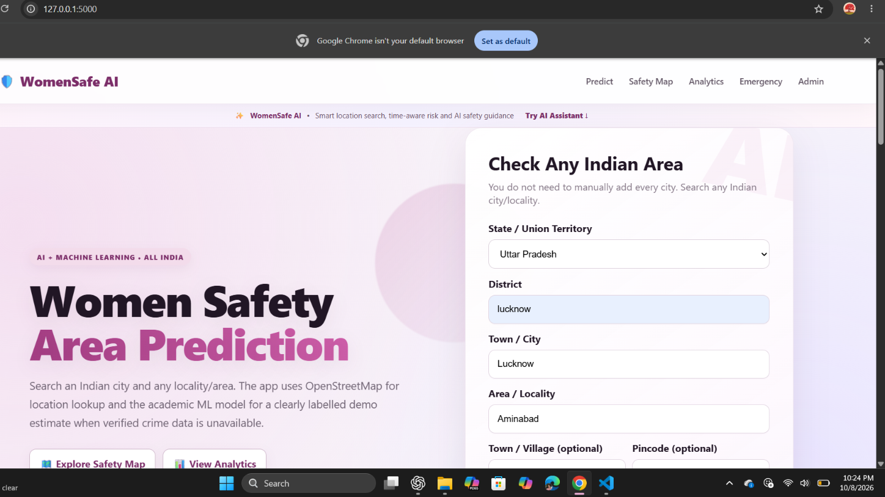
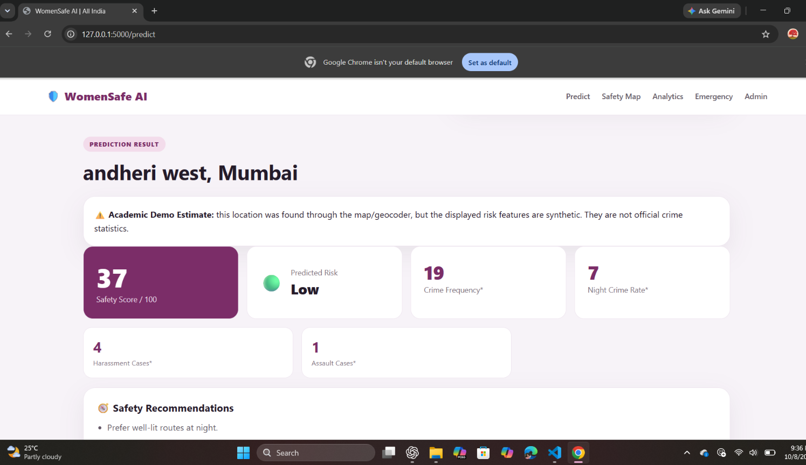
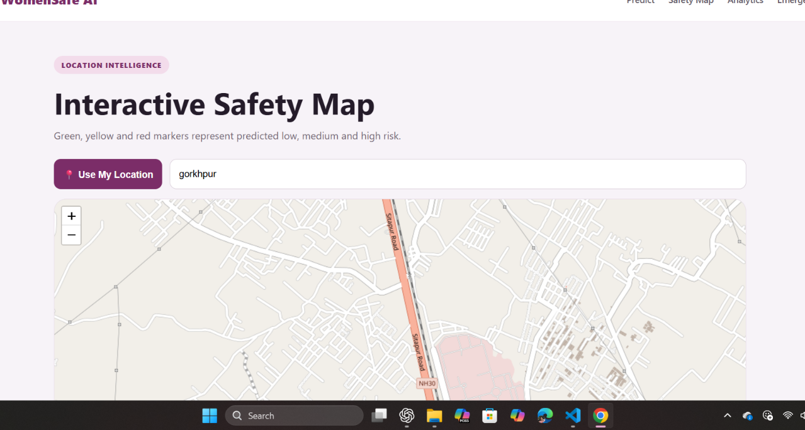
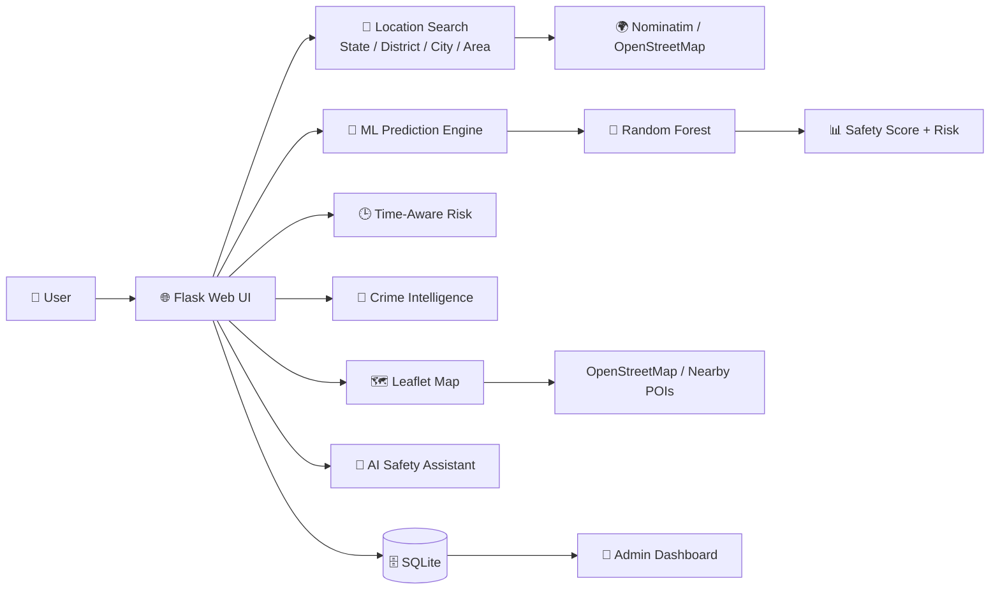

# 🛡️ WomenSafe AI — Women Safety Area Prediction System

<p align="center">
  
</p>

<p align="center">
  <a href="https://github.com/lovelygupta08947-svg/Women-Safety-AI-Prediction"></a>
  
  
  
  
</p>

> **B.Tech academic project:** an AI/ML-based women-safety analysis platform combining location search, risk prediction, time-aware risk, crime-intelligence indicators, interactive maps, nearby support and an AI safety assistant.

## ✨ Highlights

| Feature | What it does |
|---|---|
| 🔎 **Location Intelligence** | State/UT → District → Town/City → Area/Locality search |
| 🤖 **AI Safety Assistant** | Context-aware safety guidance and risk explanations |
| 🧠 **ML Prediction** | Random Forest based academic risk classification |
| 📊 **Safety Score** | 0–100 score with overall risk level |
| 🕒 **Time-Aware Risk** | Highlights comparatively higher-risk time windows |
| 🛑 **Crime Intelligence** | Displays available crime/safety indicators with clear source/status labels |
| 🗺️ **Interactive Map** | Leaflet + OpenStreetMap location visualization |
| 🚔 **Nearby Support** | Police, hospital/clinic and fire/emergency support lookup when available |
| 🚨 **Emergency** | Quick access to emergency guidance and official 112 shortcut |
| 📝 **Safety Reporting** | Community/civic safety issue reporting |
| 📈 **Analytics** | Visual summaries for safety/risk indicators |
| 🔐 **Admin** | Dashboard for project-level management and reports |

## 🖥️ Screenshots

### Home — Smart Location Search

<p align="center">
  
</p>

### Prediction — Safety & Risk Analysis

<p align="center">
  
</p>

### Interactive Safety Map

<p align="center">
  
</p>

## 🧩 System Architecture



## 🧠 How the Prediction Flow Works

```text
Location Input
     ↓
State / District / Town / Area
     ↓
Location Resolution
     ↓
Feature Preparation
     ↓
Random Forest Model
     ↓
Risk Classification
     ↓
Safety Score
     ↓
Time Risk + Crime Indicators
     ↓
Map + Nearby Support + AI Guidance
```

## 🛠️ Technology Stack

**Backend:** Python, Flask, REST-style routes  
**Machine Learning:** Scikit-learn, Random Forest, Pandas, NumPy  
**Frontend:** HTML5, CSS3, JavaScript  
**Maps:** Leaflet.js, OpenStreetMap, Nominatim, Overpass (where enabled)  
**Database:** SQLite  
**Model Artifacts:** Pickle (`.pkl`) files generated by the training script

## 📁 Project Structure

```text
Women-Safety-AI-Prediction/
├── app.py
├── train_model.py
├── requirements.txt
├── README.md
├── .gitignore
├── dataset/
│   └── crime_data.csv
├── model/
│   ├── label_encoder.pkl
│   └── safety_model.pkl
├── static/
├── templates/
└── docs/
    └── screenshots/
```

## ⚙️ Run Locally

```powershell
pip install -r requirements.txt
python train_model.py
python app.py
```

Open:

```text
http://127.0.0.1:5000
```

## 🔍 Example User Flow

**Uttar Pradesh → Lucknow → Lucknow → Aminabad**

The application can then show the location details, academic safety score/risk, time-aware risk, available crime indicators, map information and nearby support.

## 📌 Data Transparency

This project intentionally separates **location information** from **verified crime statistics**.

- Government/open-data sources can be linked where reliable data is available.
- When verified locality-level crime data is unavailable, the application labels the result as an **Academic Demo Estimate** rather than presenting synthetic values as official crime statistics.
- Location lookup may use OpenStreetMap/Nominatim.
- The application is a college project and is **not a guarantee of real-world safety**.

## 🚨 Emergency Disclaimer

For a real emergency, use official emergency services and local authorities. The application provides informational guidance and is not an emergency-response service.

## 🎓 Academic Project

**Project:** WomenSafe AI – Women Safety Area Prediction System  
**Branch:** Computer Science & Engineering  
**Institute:** Bansal Institute of Engineering and Technology, Lucknow  
**Author:** Lovely Gupta

## 📜 License

For academic/demo use. Add an open-source license later if you decide to publish the code under specific reuse terms.
